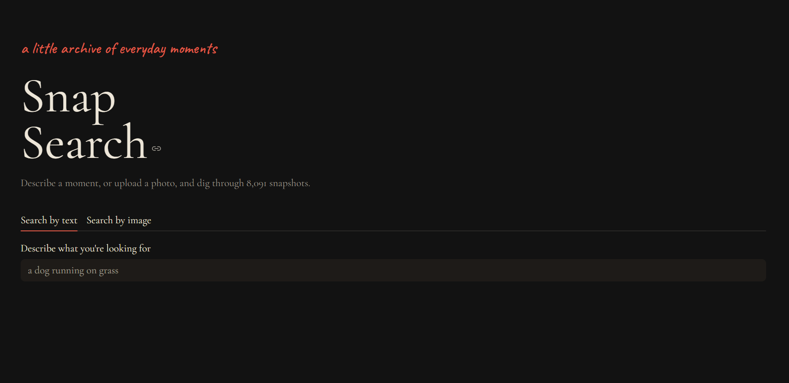
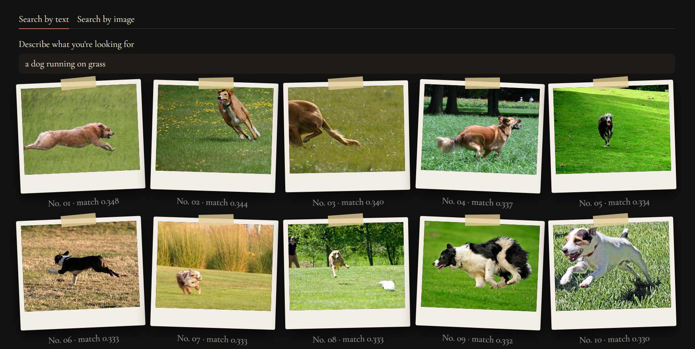
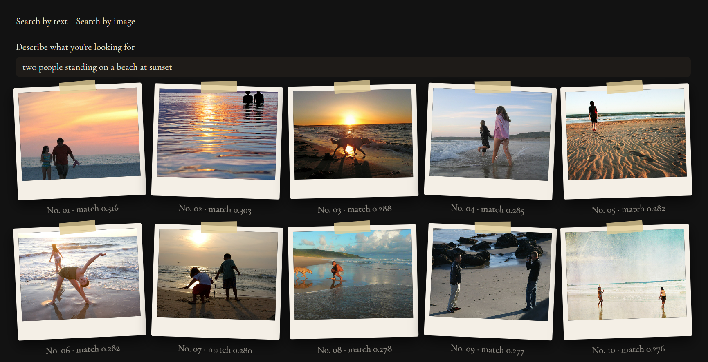
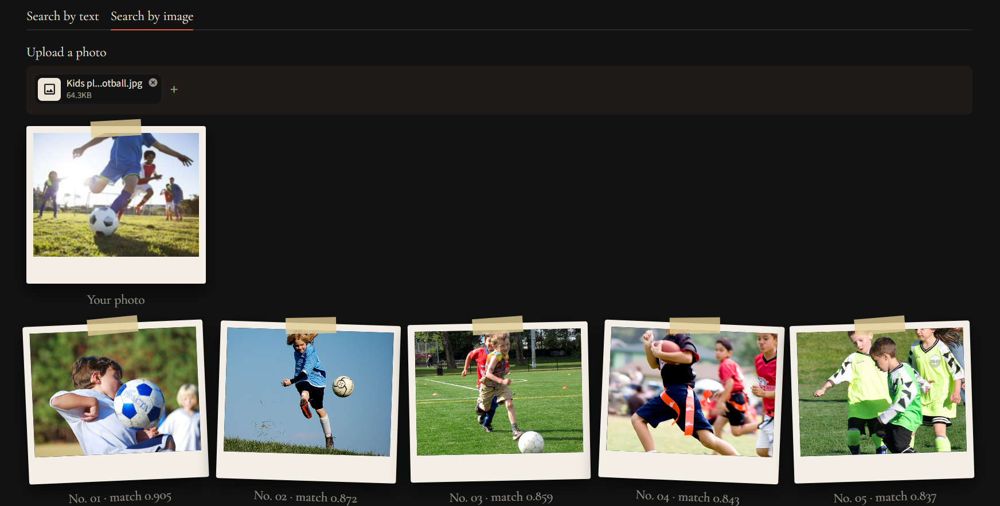

# SnapSearch

A semantic image search engine. Describe a moment in words, or upload a photo, and SnapSearch finds the closest matches from a collection of 8,091 images. It uses CLIP embeddings to compare text and images in the same space, with a Streamlit web interface.



## Features

- **Text-to-image search:** type a sentence like "two people standing on a beach at sunset" and get the 10 closest photos.
- **Image-to-image search:** upload a photo and find visually and conceptually similar ones.
- **Evaluated retrieval:** accuracy measured on 2,000 sampled captions (see Results).





## How it works

1. Every image in the dataset is converted into a 512-number embedding using CLIP (`clip-ViT-B-32`) and saved to disk.
2. A search query (a sentence or an uploaded photo) is converted into an embedding with the same model.
3. The query embedding is compared against all image embeddings using cosine similarity, and the 10 highest-scoring images are shown.

## Results

Text-to-image retrieval was evaluated on the full index of 8,091 images. Each of 2,000 randomly sampled captions was used as a search query, and a hit means the photo that caption was written for appeared in the top results.

| Metric | Result |
|---|---|
| Recall@1 | 29.4% |
| Recall@5 | 52.1% |
| Recall@10 | 62.8% |

Only the single original photo counts as correct, but many photos in the dataset look alike (for example, many dogs on grass). A different photo that also fits the caption is scored as a miss, so these numbers understate how relevant the results feel. Image-to-image search has no ground truth in this dataset, so it is judged by eye and has no accuracy score.

## Limitations

- Results depend on the collection. Flickr8k is mostly people and animals, so a query with no close match returns the nearest concept or colour instead. A flower bouquet photo returned girls in pink dresses, and an anime illustration returned a child in martial-arts clothing.
- CLIP matches meaning, not art style or exact pixels.
- Recall@1 is strict because of near-duplicate photos (see Results).
- Image-to-image search is evaluated qualitatively only.

## Tech stack

Python, sentence-transformers (CLIP), NumPy, pandas, Pillow, Streamlit

## Run it yourself

The photos are not included in this repository. They come from Flickr users and belong to their original photographers, so you download the dataset yourself.

1. Clone the repo and create an environment:

   ```bash
   git clone https://github.com/nishitaa04/snapsearch.git
   cd snapsearch
   python -m venv venv
   venv\Scripts\activate
   pip install -r requirements.txt
   ```

2. Download the [Flickr8k dataset from Kaggle](https://www.kaggle.com/datasets/adityajn105/flickr8k) and unzip it so you have `data/Images/` and `data/captions.txt`.

3. Build the index (takes a while on CPU):

   ```bash
   python build_index.py
   ```

4. Start the app (keep `USE_FULL = True` in `app.py`):

   ```bash
   streamlit run app.py
   ```

5. Optional, reproduce the accuracy numbers:

   ```bash
   python evaluate.py
   ```

## Dataset

Flickr8k: Hodosh, Young and Hockenmaier, "Framing image description as a ranking task: Data, models and evaluation metrics", Journal of Artificial Intelligence Research, 2013.